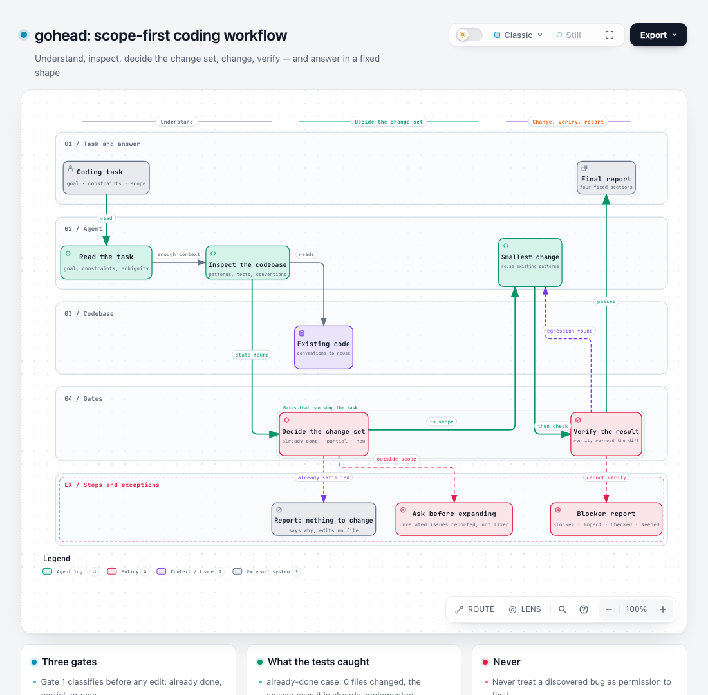
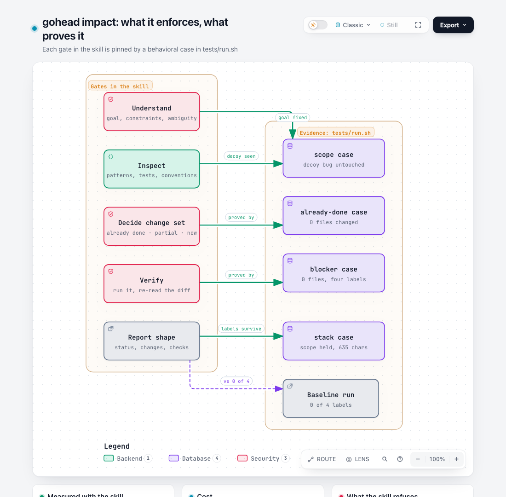

# gohead

Scope-first coding workflow for AI coding agents: understand the task, inspect the codebase, change only what the task needs, report blockers plainly, verify the result.

One skill, one file: [`skills/gohead/SKILL.md`](skills/gohead/SKILL.md).

Version 1.1.1 · [Changelog](CHANGELOG.md) · [Releases](https://github.com/akufikri/gohead/releases)

## Why gohead exists

Agents usually fail coding tasks in three repeatable ways:

1. They do not really read the context they were given — the goal, the constraints, the code around the change.
2. The adjustment lands outside the scope that was asked for: drive-by fixes, unrelated refactors, a workaround instead of the change.
3. After the adjustment nothing is re-checked, so "done" is claimed without evidence.

gohead exists to steer the agent back onto those four steps: **understand, analyse, execute, verify**. Understand the request and the code it touches; analyse what is actually in scope; execute the smallest change that meets it; then check the result before reporting.

## The flow

[Open the interactive version ↗](https://akufikri.github.io/gohead/gohead-flow.html)

One task, three gates, two exits. The task is read and the codebase inspected before anything is decided. The decide gate classifies the task and names the change set — it is the gate that answers "already implemented" without editing a file, and the one that refuses a discovered bug as permission to widen the task. The change is the smallest one that meets the task, then verified. The verify gate either passes, sends the work back for a regression, or produces a blocker report instead of a false completion.

## What it changes

[Open the interactive version ↗](https://akufikri.github.io/gohead/gohead-impact.html)

| Observed on the test fixtures | Without gohead | With gohead |
|---|---|---|
| Report labels on a blocked task | 0 of 4 | 4 of 4, every sampled run |
| Report labels on a short scoped edit | 0 of 4 | 2 of 4 sampled runs (about half) |
| `already-done` task | not measured | 0 files changed, says it is already implemented |
| Decoy file with a pre-existing bug | untouched | untouched |
| Blocked task (missing credentials) | not measured | 0 files changed, Blocker / Impact / Checked / Needed |
| Final answer length, stacked with caveman + ponytail | — | 635 characters |
| Prompt cost | — | 4,415 B, about 1,104 tokens |

Two limits are worth reading off that table instead of past it. On the trivial fixture the baseline agent also stayed in scope, so what the skill measurably adds there is the report contract, not scope discipline; `--compare` keeps that comparison visible. And the report contract itself is not fully reliable: on short edits this harness drops the section labels in roughly half the sampled runs, so the suite reports that rate as information and gates only the blocked-task format, which has held on every run.

## Diagrams

Both visuals are [Archify](https://github.com/tt-a1i/archify) diagrams, kept as typed JSON and rendered to standalone HTML, so they can be regenerated rather than redrawn:

    node bin/archify.mjs finalize workflow docs/gohead-flow.workflow.json docs/gohead-flow.html --quality showcase
    node bin/archify.mjs finalize architecture docs/gohead-impact.architecture.json docs/gohead-impact.html --quality showcase

`docs/*.delivery.json` records the spec and artifact hashes; `./tests/run.sh --static` fails if an HTML file stops matching its receipt, so the shipped diagrams cannot drift from their sources.

## Install

### skills CLI

    npx skills add akufikri/gohead

Installs `gohead` into the agent you pick, from the same command used across the [skills.sh](https://skills.sh) ecosystem.

### Symlink installer

    git clone https://github.com/akufikri/gohead.git
    cd gohead
    ./install.sh

`install.sh` symlinks `skills/gohead` into `~/.claude/skills/` and `~/.agents/skills/`, so `git pull` keeps the installed skill current. Start a new agent session afterwards so the skill is loaded.

Pass explicit directories if your agent reads skills from somewhere else:

    ./install.sh ~/.codex/skills

### Claude Code plugin

    /plugin marketplace add akufikri/gohead
    /plugin install gohead@gohead

## Use

Say `Gohead`, or ask for a scoped coding change. Invoked as a command it takes a task argument: `/gohead [coding task]`.

## What it enforces

- Understand goal, in-scope behavior and constraints before editing.
- Inspect existing code and conventions; reuse them instead of adding abstractions.
- Change only code the task needs — no drive-by fixes, cleanup, or refactors.
- Report blockers as **Blocker / Impact / Checked / Needed** instead of guessing.
- Verify, then report **Status / Changes / Checks / Blockers**.

## Tests

    ./tests/run.sh              # static contract + 4 behavioral cases
    ./tests/run.sh --static     # static only, no model calls
    ./tests/run.sh --selftest   # prove the assertions fire on planted violations
    ./tests/run.sh --compare    # extra control run without the skill

Each behavioral case runs a headless agent in a throwaway git repo and judges only observable results:

| Case | What is asserted |
|---|---|
| `scope` | The edit stays inside the asked-for file; the decoy file with a pre-existing bug is untouched; the report uses `Status:` / `Changes:`. |
| `already-done` | A task whose behavior already exists produces no file changes and says so. |
| `blocker` | Missing inputs are reported as `Blocker / Impact / Checked / Needed`, and nothing is invented. |
| `stack` | Loaded together with the installed `caveman` and `ponytail` skills, the edit still stays in scope and the final message stays under 1200 characters. |

The stacked case measures cost: it prints the skill-stack size in bytes and tokens, the run's token count, and how many of gohead's four report labels survived compression. Those numbers are informational — compression is allowed to change the wording, not the scope.

Requirements: `python3` with `yaml`, and either `omp` (default) or `claude` with `ANTHROPIC_API_KEY`. Override with `GOHEAD_AGENT=claude`, `GOHEAD_MODEL=<model>`, and `GOHEAD_EXTRA_SKILLS=path:path` to stack different skills.

## License

MIT
